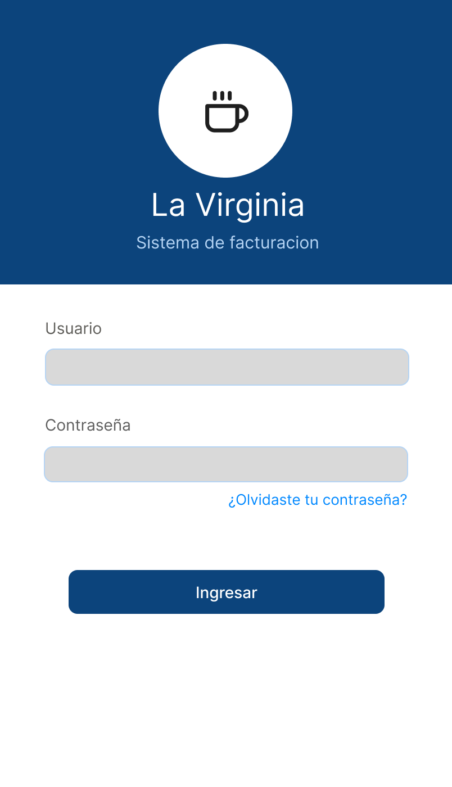
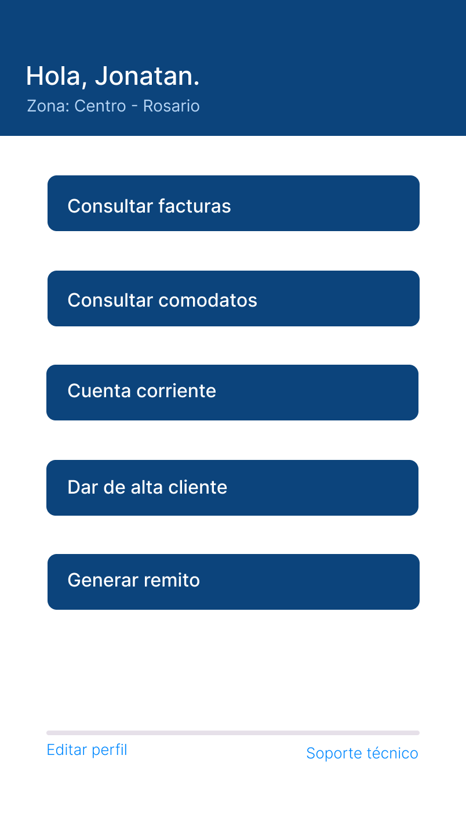
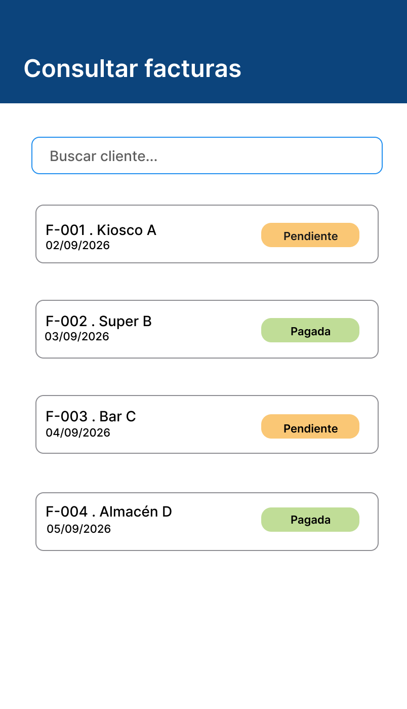
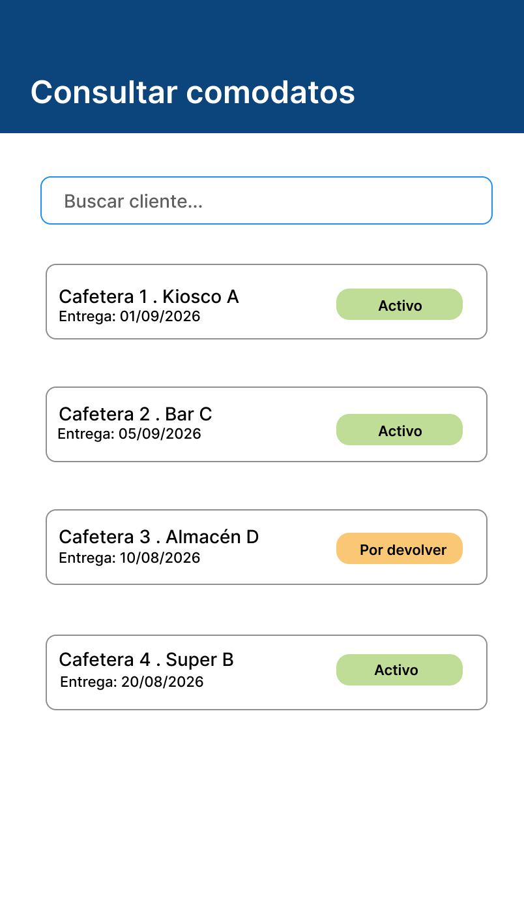
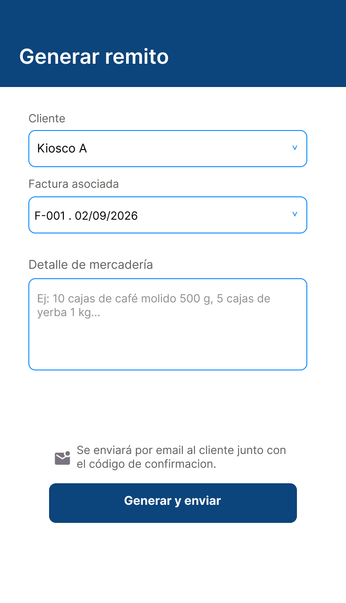
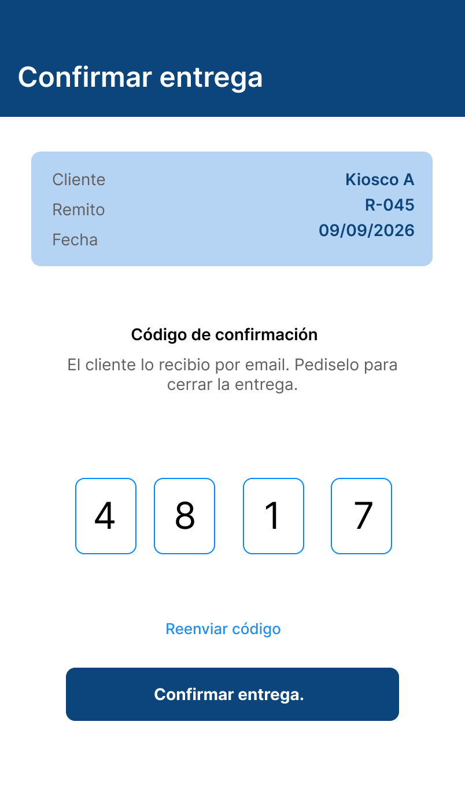
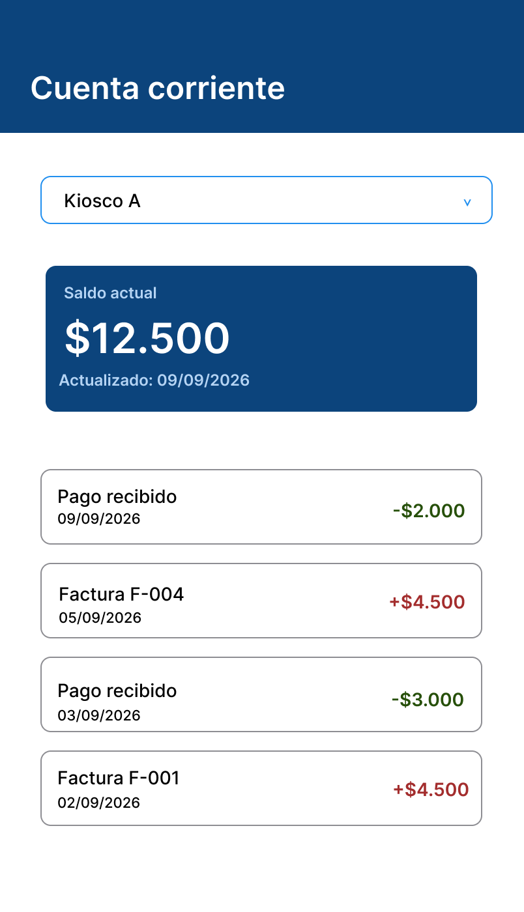
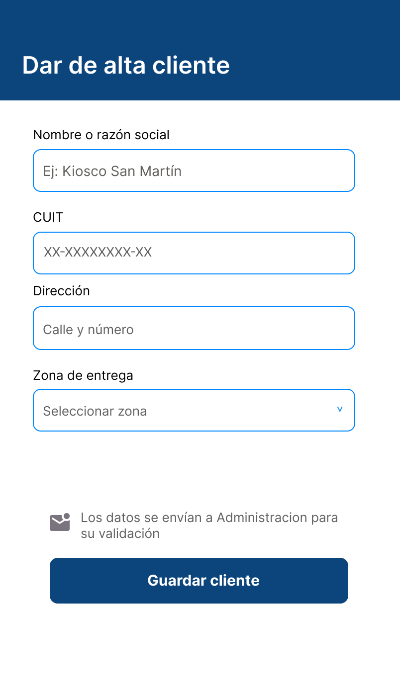
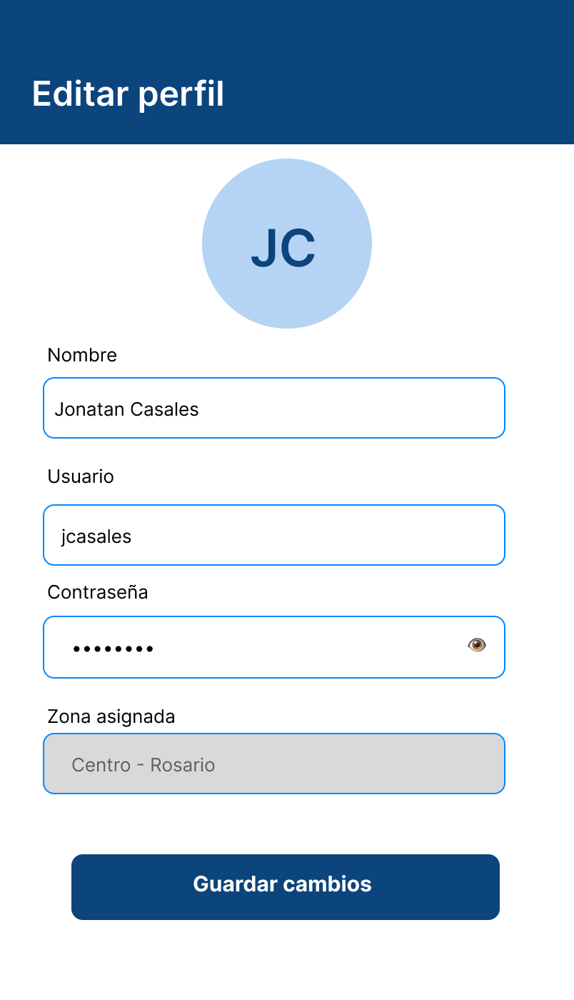

# Diseño UI

Wireframes de alta fidelidad del sistema de facturación digital de La Virginia, diseñados en Figma para uso en celular o tablet durante el reparto. Las imágenes están en `diagramas/wireframes/`.

## Criterios generales

- **Mobile-first:** el vendedor opera en la calle, desde celular o tablet.
- **Identidad visual:** azul institucional `#0C447C` sobre fondo blanco, con celeste `#B5D4F4` para bordes y detalles.
- **Consistencia:** mismo encabezado, mismos campos y mismo botón principal en todas las pantallas.
- **Estados con color:** verde para pagado o activo, amarillo para pendiente, rojo para deuda.

---

## Pantalla 1 — Login

**Wireframe:** `diagramas/wireframes/01-login.png`

**Patrones de diseño utilizados:** formulario de una sola pantalla, encabezado de marca, botón primario único, enlace secundario.

**Justificación:** el vendedor necesita ingresar rápido antes de salir a repartir, por eso solo hay dos campos y un botón destacado. El encabezado con el nombre de la empresa da identidad y confianza. El enlace de recuperación de contraseña evita depender de Administración ante un olvido.

**Formulario:**
- Cantidad de campos: 2 (usuario y contraseña)
- Flujo: todo en una pantalla
- Validaciones relevantes: ambos campos obligatorios; mensaje de error si las credenciales son incorrectas

---

## Pantalla 2 — Menú principal

**Wireframe:** `diagramas/wireframes/02-menu-principal.png`

**Patrones de diseño utilizados:** menú de accesos directos en lista de botones, encabezado con saludo contextual, enlaces secundarios al pie.

**Justificación:** concentra las cinco funciones principales del vendedor en una sola pantalla. Los botones son grandes y ocupan todo el ancho para usarse con una mano y en movimiento. El saludo con la zona asignada confirma que la sesión es la correcta. Editar perfil y soporte quedan al pie porque se usan poco.

**Formulario:** no aplica.

---

## Pantalla 3 — Consultar facturas

**Wireframe:** `diagramas/wireframes/03-consultar-facturas.png`

**Patrones de diseño utilizados:** lista de tarjetas (cards), buscador, etiquetas de estado con color.

**Justificación:** el relevamiento mostró pérdida de facturas y poca trazabilidad. Las tarjetas se leen mejor que una tabla en un celular, y la etiqueta de color permite ver de un vistazo qué está pendiente de cobro. El buscador por cliente agiliza la consulta durante la visita.

**Formulario:** no aplica (el buscador solo filtra la lista).

---

## Pantalla 4 — Consultar comodatos

**Wireframe:** `diagramas/wireframes/04-consultar-comodatos.png`

**Patrones de diseño utilizados:** lista de tarjetas, buscador, etiquetas de estado (Activo, Por devolver).

**Justificación:** reutiliza el patrón de facturas para que el usuario no tenga que aprender una interfaz nueva. Permite controlar qué máquinas de café están prestadas a cada cliente y detectar las que hay que recuperar, algo que hoy se gestiona con documentación en papel.

**Formulario:** no aplica.

---

## Pantalla 5 — Generar remito

**Wireframe:** `diagramas/wireframes/05-generar-remito.png`

**Patrones de diseño utilizados:** formulario en una pantalla con desplegables, aviso informativo, botón primario.

**Justificación:** los desplegables de cliente y factura evitan errores de tipeo y vinculan el remito con documentación existente. El aviso explica que se enviará por email al cliente, lo que reemplaza el remito impreso y reduce el uso de papel.

**Formulario:**
- Cantidad de campos: 3 (cliente, factura asociada, detalle de mercadería)
- Flujo: todo en una pantalla
- Validaciones relevantes: cliente y factura obligatorios; la factura debe pertenecer al cliente elegido; el detalle no puede quedar vacío

---

## Pantalla 6 — Confirmar entrega

**Wireframe:** `diagramas/wireframes/06-confirmar-entrega.png`

**Patrones de diseño utilizados:** campo de código segmentado (4 casilleros), tarjeta resumen de solo lectura, acción secundaria de reenvío.

**Justificación:** reemplaza la firma en papel, que era una de las principales causas de pérdida de comprobantes. El resumen del remito permite verificar que se está confirmando la entrega correcta antes de cargar el código. Los casilleros separados facilitan ingresar un código corto con el teclado numérico, y el reenvío resuelve el caso en que el email no llegó.

**Formulario:**
- Cantidad de campos: 1 (código de 4 dígitos)
- Flujo: todo en una pantalla
- Validaciones relevantes: solo números; exactamente 4 dígitos; el código debe corresponder al remito; límite de intentos fallidos

---

## Pantalla 7 — Cuenta corriente

**Wireframe:** `diagramas/wireframes/07-cuenta-corriente.png`

**Patrones de diseño utilizados:** selector de cliente, tarjeta de resumen destacada, lista de movimientos con color semántico.

**Justificación:** el dato más importante para el vendedor es cuánto debe el cliente, por eso el saldo va arriba y en tamaño grande. Los colores (verde para pagos, rojo para deuda) ayudan a detectar movimientos de un vistazo. Los relevamientos mostraron conciliaciones incorrectas y recibos duplicados, y una lista clara de movimientos facilita detectarlos. Los datos se obtienen de SAP.

**Formulario:** no aplica (solo lectura; el selector cambia el cliente consultado).

---

## Pantalla 8 — Dar de alta cliente

**Wireframe:** `diagramas/wireframes/08-alta-cliente.png`

**Patrones de diseño utilizados:** formulario corto de una sola pantalla, textos de ejemplo en los campos, desplegable para la zona.

**Justificación:** la crítica del relevamiento señaló que el formulario actual es demasiado largo y repetitivo. Esta versión pide solo los datos esenciales. Los textos de ejemplo reducen errores de carga y los datos se envían a Administración para su validación, sin papel.

**Formulario:**
- Cantidad de campos: 4 (nombre o razón social, CUIT, dirección, zona de entrega)
- Flujo: todo en una pantalla
- Validaciones relevantes: todos los campos obligatorios; CUIT de 11 dígitos con formato válido; zona elegida de una lista cerrada

---

## Pantalla 9 — Editar perfil

**Wireframe:** `diagramas/wireframes/09-editar-perfil.png`

**Patrones de diseño utilizados:** avatar con iniciales, formulario con campo bloqueado, mostrar u ocultar contraseña.

**Justificación:** permite al vendedor mantener sus datos sin pedir ayuda a Administración. La zona asignada aparece bloqueada porque la define Administración, y mostrarla igual ayuda a que el usuario verifique que es la correcta.

**Formulario:**
- Cantidad de campos: 4 (nombre, usuario, contraseña y zona; la zona es de solo lectura)
- Flujo: todo en una pantalla
- Validaciones relevantes: campos obligatorios; usuario único; contraseña con longitud mínima

---

## Consideraciones de accesibilidad

- **Contraste alto para uso en la calle:** el vendedor usa el sistema al aire libre, con sol directo sobre la pantalla. Por eso el texto principal es azul oscuro `#0C447C` sobre fondo blanco, y el texto de los botones es blanco sobre ese mismo azul, combinaciones de contraste muy alto que se leen aun con reflejos.
- **El color nunca es la única señal:** los estados llevan texto (Pendiente, Pagada, Activo, Por devolver) y los montos de la cuenta corriente llevan signo (+ o -) además del color rojo o verde. Así se entienden también con